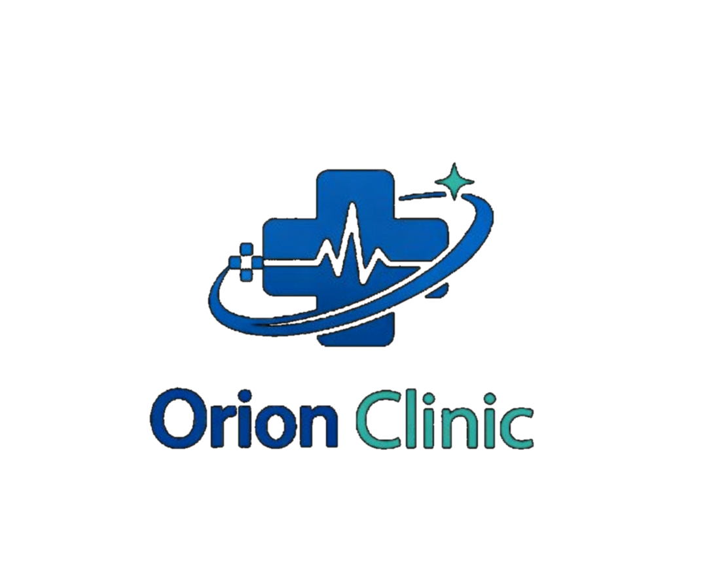

<p align="center">
  
</p>

<h1 align="center">🏥 Orion Clinic — Platform Telemedisin</h1>

<p align="center">
  <strong>Sistem konsultasi kesehatan digital berbasis web untuk klinik modern</strong>
</p>

<p align="center">
  
  
  
  
</p>

---

## 📋 Tentang Proyek

**Orion Clinic** adalah platform telemedisin terpadu yang menghubungkan pasien, dokter, apoteker, dan administrator klinik dalam satu ekosistem digital. Dibangun menggunakan **CodeIgniter 4** dengan antarmuka responsif **Tailwind CSS**, sistem ini mendukung alur konsultasi kesehatan dari booking jadwal hingga penebusan resep obat secara *end-to-end*.

> Proyek ini dikembangkan sebagai bagian dari tugas mata kuliah Semester 5 (SMT5) — Universitas Dian Nuswantoro.

---

## ✨ Fitur Utama

### 👤 Pasien
- Pendaftaran akun & manajemen profil lengkap (alergi, riwayat penyakit, golongan darah)
- Pencarian & booking konsultasi dokter berdasarkan jadwal praktik
- Sistem antrean digital dengan kode unik
- Pembayaran konsultasi dengan upload bukti transfer
- Chat real-time dengan dokter selama sesi konsultasi
- Riwayat konsultasi & detail rekam medis
- E-resep digital dan penebusan obat
- Pengelolaan data anggota keluarga (dependents)
- Notifikasi real-time untuk status booking & resep
- Halaman Wellness untuk informasi kesehatan

### 🩺 Dokter
- Dashboard ringkasan jadwal & pasien hari ini
- Manajemen jadwal praktik per hari (Senin–Jumat)
- Persetujuan / penolakan janji temu pasien
- Ruang chat konsultasi dengan lampiran file
- Penulisan catatan klinis, diagnosis, dan e-resep
- Riwayat lengkap pasien yang pernah ditangani
- Toggle status ketersediaan (Online / Offline / Busy)

### 💊 Farmasi (Apoteker)
- Dashboard penerimaan resep digital dari dokter
- Alur status obat: *Redeemed → Preparing → Ready → Completed*
- Notifikasi otomatis ke pasien saat status obat berubah

### 🛡️ Administrator
- Dashboard statistik klinik (pendapatan, jumlah pasien, jumlah dokter)
- Manajemen akun pengguna (semua role)
- Verifikasi dokter baru
- Kelola master spesialisasi dokter
- Laporan keuangan dan riwayat transaksi
- Audit log aktivitas admin

---

## 🏗️ Arsitektur Database

Sistem menggunakan **15 tabel** yang saling berelasi:

```
users ──┬── patients ──── appointments ──── consultations ──┬── prescriptions ──── prescription_items
        │                      │                │           └── medical_records
        │                      │                └── messages
        │                      └── payments
        ├── doctors ──── doctor_schedules
        ├── family_members
        ├── notifications
        └── audit_logs

specializations (Master Spesialisasi)
```

Diagram lengkap tersedia di [`database-schema.puml`](database-schema.puml) (format PlantUML).

---

## 🚀 Instalasi & Menjalankan

### Prasyarat

| Software | Versi Minimum |
| :--- | :--- |
| PHP | 8.2+ |
| Composer | 2.x |
| MySQL / MariaDB | 5.7+ / 10.3+ |
| Ekstensi PHP | `intl`, `mbstring`, `mysqli`, `mysqlnd`, `json` |

### Langkah-langkah

**1. Clone repository**

```bash
git clone https://github.com/masjoncpp/devorionclinic.git
cd devorionclinic
```

**2. Install dependensi**

```bash
composer install
```

**3. Konfigurasi environment**

```bash
cp .env.example .env
```

Edit file `.env` dan sesuaikan kredensial database:

```ini
database.default.hostname = localhost
database.default.database = orionclinic
database.default.username = root
database.default.password = 
database.default.port = 3306
```

**4. Buat database**

Pilih salah satu metode:

<details>
<summary><strong>Metode A: Import file SQL (Tercepat)</strong></summary>

```bash
# Menggunakan sudo (Ubuntu/Debian)
sudo mysql < orionclinic.sql

# Atau dengan user & password
mysql -u root -p < orionclinic.sql
```

File `orionclinic.sql` sudah mencakup pembuatan database, seluruh tabel, foreign keys, dan data awal.

</details>

<details>
<summary><strong>Metode B: Menggunakan Migration & Seeder (CI4 Spark)</strong></summary>

```sql
-- Di MySQL/MariaDB prompt:
CREATE DATABASE orionclinic CHARACTER SET utf8mb4 COLLATE utf8mb4_unicode_ci;
```

```bash
php spark migrate
php spark db:seed TelemedicineSeeder
```

</details>

**5. Jalankan development server**

```bash
php spark serve
```

Buka browser di **http://localhost:8080** 🚀

---

## 🔐 Akun Default

Setelah seeding/import, akun berikut tersedia untuk pengujian:

| Role | Email | Password | Halaman |
| :--- | :--- | :--- | :--- |
| **Admin** | `admin@clinic.com` | `admin123` | `/admin` |
| **Farmasi** | `farmasi@clinic.com` | `farmasi123` | `/pharmacy` |
| **Dokter** | `sarah@clinic.com` | `password123` | `/doctor` |
| **Dokter** | `andi@clinic.com` | `password123` | `/doctor` |
| **Dokter** | `maya@clinic.com` | `password123` | `/doctor` |
| **Pasien** | `budi@gmail.com` | `password123` | `/patient` |

---

## 📁 Struktur Proyek

```
devorionclinic/
├── app/
│   ├── Config/            # Konfigurasi framework (Routes, Database, Filters)
│   ├── Constants/         # Konstanta aplikasi (SVG Icons)
│   ├── Controllers/       # Controller utama (Auth, Patient, Doctor, Admin, Pharmacy, Chat)
│   ├── Database/
│   │   ├── Migrations/    # File migrasi skema database
│   │   └── Seeds/         # Seeder data awal
│   ├── Filters/           # Auth & Role middleware
│   ├── Helpers/           # Helper kustom (icon_helper)
│   ├── Models/            # 14 model Eloquent-style
│   └── Views/
│       ├── admin/         # 7 halaman panel admin
│       ├── auth/          # Login & register
│       ├── components/    # Sidebar & navigasi
│       ├── doctor/        # 8 halaman panel dokter
│       ├── layouts/       # Template utama
│       ├── patient/       # 12 halaman panel pasien
│       └── pharmacy/      # Dashboard farmasi
├── public/                # Document root (index.php, assets, CSS, JS)
├── orionclinic.sql        # Dump SQL lengkap (DDL + data awal)
├── database-schema.puml   # Diagram ER (PlantUML)
└── .env.example           # Template konfigurasi environment
```

---

## 🛣️ Alur Sistem

```
┌─────────┐    Booking     ┌─────────────┐    Bayar     ┌──────────┐
│  Pasien  │──────────────▶│ Janji Temu   │────────────▶│ Payment  │
└─────────┘                └─────────────┘              └──────────┘
                                  │                          │
                           Dokter Setujui               Lunas ✓
                                  ▼                          │
                           ┌─────────────┐                   │
                           │ Konsultasi  │◀──────────────────┘
                           │   (Chat)    │
                           └─────────────┘
                                  │
                        Diagnosis & Resep
                                  ▼
                           ┌─────────────┐    Siapkan    ┌──────────┐
                           │  E-Resep    │──────────────▶│ Farmasi  │
                           └─────────────┘               └──────────┘
                                  │                          │
                           Rekam Medis                  Obat Siap ✓
                                  ▼                          │
                           ┌─────────────┐                   │
                           │  Riwayat    │◀──────────────────┘
                           └─────────────┘
```

---

## 🧪 Menjalankan Test

```bash
vendor/bin/phpunit
```

---

## 🛠️ Tech Stack

| Layer | Teknologi |
| :--- | :--- |
| **Backend** | PHP 8.2+, CodeIgniter 4.7 |
| **Frontend** | Tailwind CSS (CDN), jQuery 3.7, SweetAlert2 |
| **Database** | MySQL / MariaDB dengan Foreign Key Constraints |
| **Font** | Plus Jakarta Sans (Google Fonts) |
| **Icon** | Custom SVG Icon System (inline, tanpa dependensi) |

---

## 👥 Tim Pengembang

| Nama | NIM | Peran |
| :--- | :--- | :--- |
| M. Jottie Ramadhan Putu Sigit | 111202416048 | Fullstack Developer |

> **Universitas Dian Nuswantoro** — Semarang, 2026

---

## 📄 Lisensi

Proyek ini dilisensikan di bawah [MIT License](LICENSE).
